# DS 搜索（DS Search）

macOS 菜单栏里的极简个人搜索：基于 [DeepSeek](https://platform.deepseek.com) 的 Search / Fetch / Chat API，纯 Go + [MyGo](https://github.com/egoist/mygo) 原生 UI（GPU 绘制，没有 WebView）。⌥空格 唤起，打字，回车：先搜，再总结，右边是带 [n] 引用的 AI 总结，左边是它读的来源；按 ⇧⇥ 收起 AI 栏只看结果，还能联网追问。

> 非 DeepSeek 官方产品，与 DeepSeek（杭州深度求索）无任何关联。需要你自己的 DeepSeek API Key，费用由你的 DeepSeek 账户承担。

[English](#english) · [截图](#截图) · [功能](#功能) · [安装](#安装) · [快捷键](#使用与快捷键) · [隐私](#隐私) · [开发](#从源码构建)

## 截图

| 浅色 | 深色 |
|---|---|
| 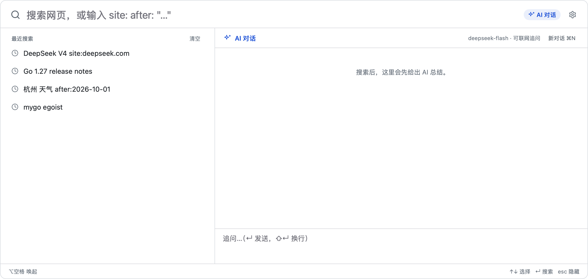 | 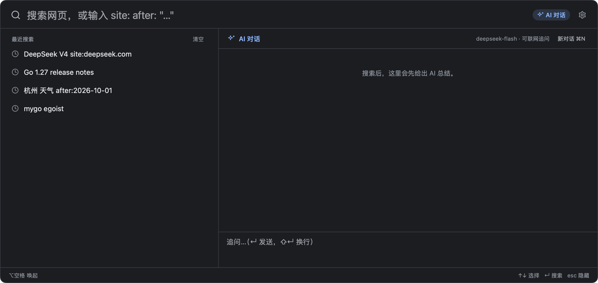 |
| 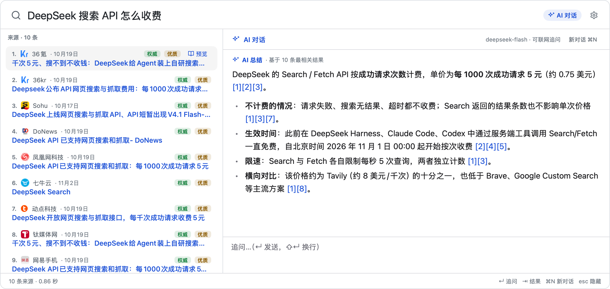 | 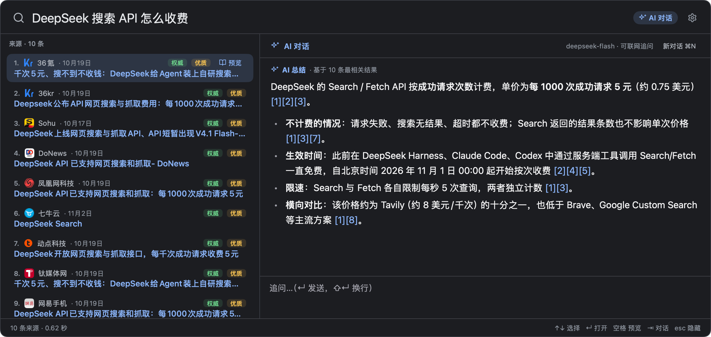 |
| 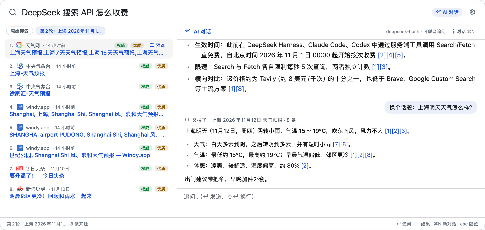 | 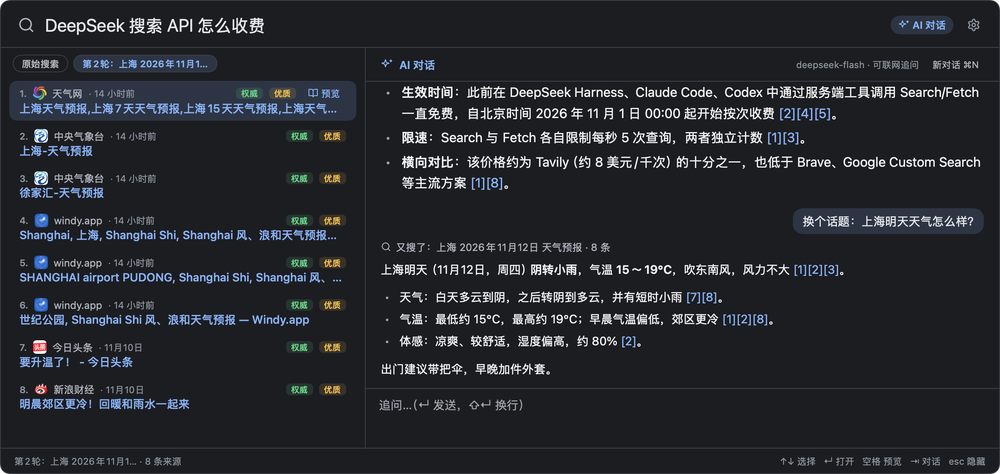 |
| 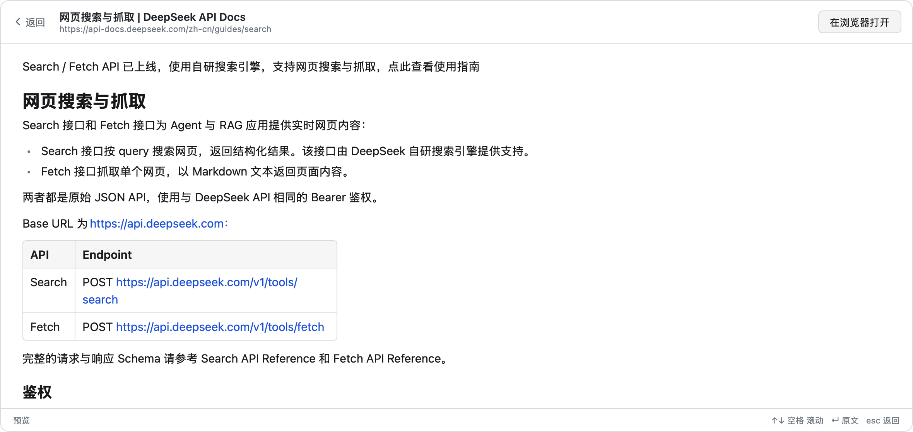 | 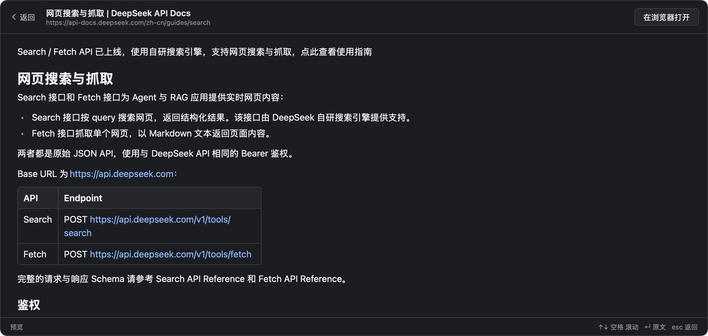 |
| 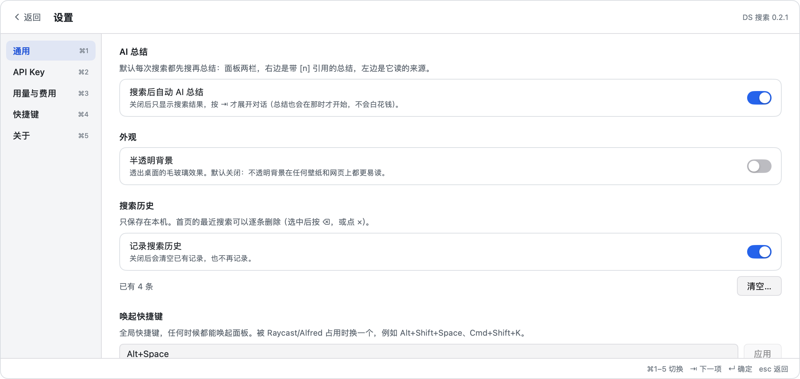 | 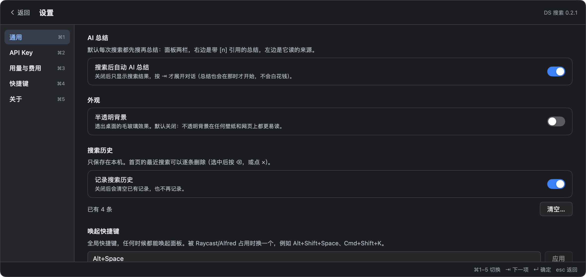 |
| 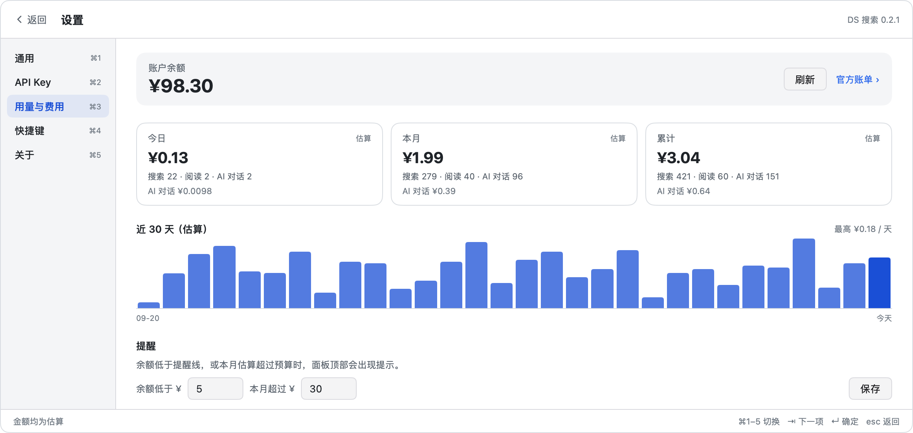 | 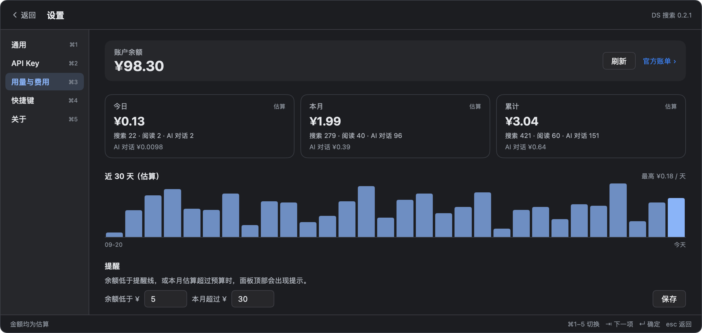 |

## 功能

- **菜单栏常驻**，无 Dock 图标；全局快捷键 **⌥空格**（可改）唤起 Spotlight 式浮动面板，全键盘操作，支持中文输入法。
- **网页搜索**：DeepSeek Search API，支持 `site:`、`-site:`、`"精确短语"`、`lang:`、`after:`、`before:`；无限滚动（先取 10 条，滚到底再取到 50 条）；站点图标、日期、「优质 / 权威」标记。
- **阅读模式**：空格预览网页正文（DeepSeek Fetch API）。
- **AI 总结（默认）**：每次搜索默认先搜再总结，右栏对前 10 条结果做带 [n] 引用的总结，左栏是它读的来源；⇧⇥ 收起 AI 栏只看结果，设置 › 通用 可默认关掉（关掉后按 ⇥ 展开对话时才开始总结）。可多轮追问，模型觉得来源不够时会自己再搜（Function Calling，每轮最多 2 次），点 [n] 在左侧定位来源。
- **用量与费用**：本机估算今日 / 本月 / 累计花费、近 30 天柱状图、账户余额、低余额和月度预算提醒。
- **原生体验**：浅色 / 深色、可拖动分栏与面板尺寸（都会记住）、可选半透明背景、搜索历史可逐条删除或关闭。

## 安装

### 下载

1. 从 [Releases](../../releases) 下载 `DS-Search-<版本>-macos-universal.zip`（Apple Silicon 与 Intel 通用），解压后把 `DS Search.app` 拖进「应用程序」。
2. 这个包**没有 Apple 开发者签名和公证**（只是 ad-hoc 签名），第一次打开会被 Gatekeeper 拦下。任选一种：
   - Finder 里右键 App → 打开 → 再点「打开」；或到「系统设置 → 隐私与安全性」点「仍要打开」；
   - 或在终端运行：
     ```sh
     xattr -dr com.apple.quarantine "/Applications/DS Search.app"
     ```
3. 首次启动会进入设置，粘贴你的 DeepSeek API Key（在 [platform.deepseek.com](https://platform.deepseek.com/api_keys) 创建）→「验证并保存」。

### 从源码构建

需要 Go 1.27+。纯 Go、无 cgo，在任何系统上都能交叉编译出 macOS 版：

```sh
git clone https://github.com/horizon0514/ds-search.git
cd ds-search
go tool mygo build -platform darwin/universal   # 产出 build/darwin-universal/DS Search.app
scripts/sign.sh                                 # ad-hoc 签名（macOS 用 codesign，其他系统需要 rcodesign）
```

签名用固定的标识符 `dev.horizon.dssearch`，指定要求只认这个标识符，这样新版本仍能读到钥匙串里的 Key。自己重签时请保留：

```sh
codesign --force --deep -s - -i dev.horizon.dssearch -r='designated => identifier "dev.horizon.dssearch"' "/Applications/DS Search.app"
```

## API Key 与费用（自带 Key）

DS 搜索不提供任何服务端，所有请求都用你自己的 DeepSeek API Key、从你的电脑直接发到 DeepSeek。

- Search、Fetch（阅读模式）各 **¥5 / 1000 次**（¥0.005/次），只对有结果的成功请求计费；每次搜索算 1 次，与返回条数无关。
- AI 对话按 `deepseek-flash` 的 token 计费：一次总结约 3–5k 输入 token；带搜索的追问多 1–2 次调用外加每次搜索 ¥0.005，一般在几分钱以内。
- 应用里的金额是本机估算，**以 [DeepSeek 账单](https://platform.deepseek.com/usage) 为准**；价格表在 `billing/billing.go`，DeepSeek 调价时可能过时。

## 使用与快捷键

像 Spotlight 一样用：⌥空格 唤出，打字，↵ 搜索并自动 AI 总结。搜索结果先出来（左侧），紧跟上是 AI 总结（右侧）；键盘默认落在来源列表上，直接打字就能改搜索词。

| 分类 | 按键 | 作用 |
|---|---|---|
| 输入框 | ↵ | 搜索，并让 AI 总结（默认自动） |
|  | ↓ | 进入来源列表 |
| 来源（左侧） | ↑ ↓ | 选择（滚到底自动加载更多） |
|  | ↵ | 在浏览器打开 |
|  | 空格 | 预览（阅读模式） |
|  | ⇥ | 在来源与对话之间切换（AI 栏关闭时先展开） |
|  | ⇧⇥ | 收起 / 展开 ✨ AI 栏 |
|  | ⌘C | 复制链接 |
|  | 直接打字 / ⌫ | 回到输入框改搜索词（支持中文输入法） |
|  | ⌘↑ ⌘↓ | 到第一条 / 最后一条 |
| AI 对话（右侧） | ↵ / ⇧↵ | 发送追问 / 换行 |
|  | ⇥ | 回到来源列表 |
|  | ⌘N | 新对话（清空对话，保留搜索结果） |
|  | esc | 隐藏面板（收起 AI 栏用 ⇧⇥） |
| 预览 | ↑ ↓ / 空格 | 滚动 |
|  | ↵ | 在浏览器打开原文 |
|  | esc / ← | 返回结果 |
| 通用 | ⌥空格 | 唤起 / 隐藏面板（设置里可改） |
|  | ⌘, | 设置 |
|  | ⌘U | 设置 › 用量与费用 |
|  | ⌘/ | 快捷键表 |
|  | ⌘Q | 退出 DS 搜索 |

不显示在提示栏里的别名（快捷键表里有）：结果里 ⌘1…⌘9 打开第 N 条、⌥← ⌥→ 切换来源列表（原始搜索 / 各轮追问搜到的）、⌘L 回到输入框并全选、PageUp/PageDown 跳 6 条；对话里 ⌘1…⌘9 在左侧选中来源 [N]（再按一次打开）、⌘↵ 打开左侧选中的来源、输入框为空时 ↑ 取回上一个问题。

- 搜索语法原样传给 DeepSeek：`site:github.com`、`-site:x.com`、`"精确短语"`、`-广告`、`lang:zh,en`、`after:2026-01-01`、`before:2026`。
- 无限滚动：第一次搜索只取 10 条（快）；滚到离底部约 150px，或用 ↓ 选到倒数第 2 条时，用同一个搜索词再请求一次 50 条（DeepSeek 搜索没有 offset 参数，最多 50 条），按 URL 去重后追加到下面，滚动位置和选中项不变。加载时底部显示「加载中…」，加载完显示「已显示全部 N 条」；失败显示「加载失败，↵ 重试」。每个搜索词最多多请求这一次。
- 结果显示：站点图标、站点名、日期（北京时间）、标题、「优质 / 权威」标记（`rerank_score ≥ 1.5` 标「优质」，`authority ≥ 3` 标「权威」）；选中那条出现「预览」（空格读全文）。AI 栏展开时来源是一行一条，行首编号与总结里的 [n] 一一对应，不显示域名和摘要，把版面让给总结；关掉 AI 栏时是完整行（另有域名与两行摘要）。
- 两种布局：默认两栏（约 1180 px，居中，小屏自动收窄），右边是 ✨ AI 总结，左边是带编号的来源（430 px）。按 ⇧⇥ 收起 AI 栏，面板回到单栏（约 720 px），只剩结果；再按 ⇧⇥、按 ⇥ 或设置 › 通用 的「搜索后自动 AI 总结」可展开。展开状态会记住。
- AI 总结：第一条回答是对前 10 条结果中 rerank_score 最高者的总结，带 [n] 角标；来源行前的编号与 [n] 一一对应。之后可以在右下角追问（多轮，deepseek-flash 非思考模式，流式）。
- 费用：关闭「搜索后自动 AI 总结」后，搜索不会调用 Chat API，只有按 ⇥ 展开时才总结，不会白花钱。
- 联网追问：模型带一个 `web_search(query, count?)` 工具（DeepSeek Function Calling，流式），自己判断已有来源够不够；不够就再搜，每轮最多 2 次，对话里会显示「又搜了：xxx · N 条」。这一轮的 [n] 对应这一轮搜到的来源（从 [1] 编号，第二次搜接着编号）；没搜的轮次沿用上一份来源的编号。
- 来源切换：某一轮搜了，左侧列表就切到那一轮的来源；顶部的小标签（「原始搜索」「第2轮：xxx」…）可以来回切。点回答里的 [n] 会在左侧选中那条来源，再点一次在浏览器打开。
- 对话只在内存里：新搜索或 ⌘N 会清空，并取消进行中的回答和搜索。
- 数据目录 `~/Library/Application Support/DS Search/`（0.2.0 及以前误放在 `…/DS 搜索/`，启动时自动搬过来）：`config.json`（快捷键、历史、面板尺寸、分栏比例、外观，不含 Key）、`usage.json`（用量账本）、`api-key`（仅在用本地文件保存 Key 时存在）。对话内容不落盘。
- 搜索历史：首页最近搜索悬停出现 ×，或 ↑↓ 选中后按 ⌫ / ⌘⌫ 删除；「清空」需再点一次确认；设置 › 通用 可关闭历史。
- 面板：默认不透明（浅色/深色实底、细边框和阴影，文字对比度满足 WCAG AA），设置 › 通用 可开「半透明背景」。拖动面板边缘改大小，展开/收起两种宽度和高度分别记住。AI 两栏中间的分隔条可拖动（左栏 ≥300、右栏 ≥340），双击恢复默认，比例会记住。
- 菜单栏图标：左键、右键都弹出菜单：今日费用/余额、打开搜索、用量与费用、设置、开机自动启动、退出 DS 搜索（⌘Q）。面板里 ⌘Q 或 设置 › 关于 里的「退出」也能退出。


## 设置

左侧分页：通用 / API Key / 用量与费用 / 快捷键 / 关于（⌘1–⌘5 切换，⌘, 打开，⌘U 直达用量）。

通用 的第一项是「搜索后自动 AI 总结」（默认开）。关掉它，回车只搜索、不调用 Chat API，按 ⇥ 展开对话时才开始总结；展开时结果已经在屏上，会立即补一次总结。

## 用量与费用（设置 › 用量与费用，⌘U，或菜单栏）

- 本机账本 `~/Library/Application Support/DS Search/usage.json`，按天汇总：搜索、阅读（各 ¥0.005/次成功请求）和 AI 对话（每次调用都算，包括工具调用的中间轮次；按接口返回的 usage：缓存命中/未命中输入、输出 token × deepseek-flash 单价，区分北京时间高峰 9–12、14–18 点工作日与空闲时段半价）。失败、无结果的请求不记账。AI 追问时模型自己发起的搜索也按 ¥0.005/次 记入「搜索」。
- 显示今日 / 本月 / 累计估算金额和各类次数、近 30 天柱状图、账户余额（`GET /user/balance`，打开设置/用量页时刷新，每 20 次计费调用后自动刷新）。
- 余额低于提醒线（默认 ¥5）或本月估算超过月度预算（可选）时，面板顶部显示提醒条。
- 菜单栏右键第一行显示「今日 ¥0.12（估算）· 余额 ¥98.30」。
- 价格表集中在 `billing/billing.go` 顶部，DeepSeek 调价时改那里即可。本地数字都是估算（节假日按高峰算会略偏高；中途取消的 AI 回答可能没拿到 usage），以 platform.deepseek.com 账单为准。


## 隐私

- **API Key** 保存在 macOS「登录」钥匙串（服务名 `dev.horizon.dssearch`，账户 `deepseek-api-key`）；钥匙串不可用时可改用备用文件 `~/Library/Application Support/DS Search/api-key`（权限 0600）。Key 不写日志、不上传到别处。
- **没有遥测、没有统计、没有自己的服务器。** API 请求只发往 `api.deepseek.com`。另外，结果列表里的站点图标是直接从结果网站（及 DeepSeek 返回的图标地址）加载的；你打开、预览的网页由浏览器或 DeepSeek Fetch 获取。
- 本机数据都在 `~/Library/Application Support/DS Search/`：`config.json`（快捷键、搜索历史、面板尺寸等，不含 Key）、`usage.json`（用量账本）。AI 对话只在内存里，不落盘。搜索历史可在设置里关闭或清空。

## 路线图

- [ ] Developer ID 签名与公证，免去 Gatekeeper 提示
- [ ] 自动更新 / Homebrew Cask
- [ ] 英文界面
- [ ] 可选的对话保存与导出
- [ ] 更多搜索过滤（时间范围、站点收藏）

欢迎在 Issues 里提建议，见 [CONTRIBUTING.md](CONTRIBUTING.md)。

## 开发

```sh
go tool mygo dev                              # 本机（macOS）运行，热重载
go vet ./... && go test -short ./...          # 单元测试 + 无窗口的界面测试（不需要 API Key）
DEEPSEEK_API_KEY=sk-... go test ./...          # 加上真实 API 测试（会产生少量费用），并把截图渲染到 shots/
```

目录：`billing/`（价格表、费用计算、本地账本，含单元测试）、`usage.go`（用量页逻辑）、`dsapi/`（Search/Fetch/Answer 客户端，含真实 API 测试）、`model.go`（状态与动作）、`view.go`（界面）、`main.go`（菜单栏、面板、全局快捷键）、`config.go`（配置）、`keystore.go`（钥匙串、迁移与本地文件备用）、`settings.go`（设置分页）。

## 致谢

- [MyGo](https://github.com/egoist/mygo)（MIT）：Go 原生 UI 与桌面应用框架
- [purego](https://github.com/ebitengine/purego)（Apache-2.0）、[go-text/typesetting](https://github.com/go-text/typesetting)（Unlicense / BSD-3-Clause）、[golang.org/x/image](https://pkg.go.dev/golang.org/x/image)、[golang.org/x/text](https://pkg.go.dev/golang.org/x/text)（BSD-3-Clause）
- [DeepSeek API](https://api-docs.deepseek.com/zh-cn/)

依赖的许可证全文见 [THIRD_PARTY_NOTICES.md](THIRD_PARTY_NOTICES.md)，均与 MIT 兼容。

## 免责声明

本项目是个人开源项目，**不是 DeepSeek 官方产品，与 DeepSeek 没有任何隶属、合作或背书关系**。DeepSeek 名称与商标归其所有者。使用本软件产生的 API 费用由你自己的 DeepSeek 账户承担；费用估算仅供参考。软件按「原样」提供，不作任何担保。

## 许可证

[MIT](LICENSE) © 2026 horizon0514

---

## English

**DS Search** is a tiny macOS menu-bar search app built on the [DeepSeek](https://platform.deepseek.com) Search, Fetch and Chat APIs, with a native GPU-rendered UI in pure Go via [MyGo](https://github.com/egoist/mygo) (no WebView).

- Press **⌥Space** for a Spotlight-style panel; type, hit **Enter**: it searches, then the AI summarizes. The answer with its [n] citations is the headline on the right, the web results become the **sources** on the left. **Shift+Tab** drops back to results-only search, **Esc** hides the panel. Infinite scroll, site icons, reader mode (Space).
- **Tab** moves between the sources and the conversation: follow-up questions, and agentic web search when the model thinks the sources aren't enough. Summarizing is on by default; Settings → General turns it off, and then a search costs nothing but the search.
- Usage & cost estimates, balance and budget alerts; light/dark themes; resizable panes.
- **Bring your own DeepSeek API key.** Search/Fetch cost ¥0.005 per successful request; chat is billed by tokens on your own DeepSeek account.
- **Privacy:** the key is stored in the macOS login keychain (or an optional 0600 file); no telemetry and no server of our own. API calls go only to `api.deepseek.com`; result favicons load from the result sites.
- **Install:** download the universal zip from Releases (ad-hoc signed, not notarized: right-click → Open, or `xattr -dr com.apple.quarantine "/Applications/DS Search.app"`), or build with Go 1.27+: `go tool mygo build -platform darwin/universal`.
- The UI is in Chinese for now; an English UI is on the roadmap.

Not affiliated with, endorsed by, or sponsored by DeepSeek. MIT licensed.
